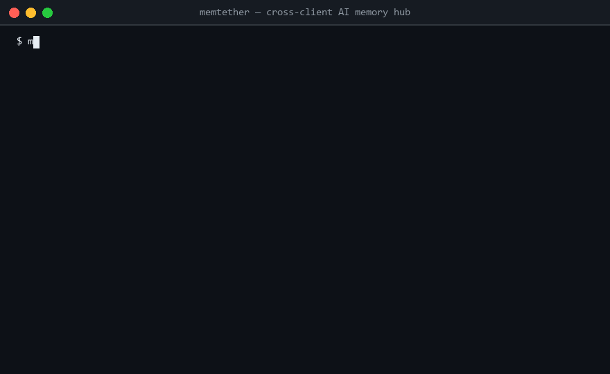

<div align="center">

<!-- PyPI does not resolve repo-relative image paths, so the primary src stays
     relative for GitHub and an onerror fallback points at the raw GitHub URL.
     Without this the PyPI project page shows a broken image as its first
     screen (this fallback existed once and was lost in a later rewrite). -->
<picture>
  <source srcset="https://raw.githubusercontent.com/MemTether/MemTether/main/assets/demo.gif" media="(min-width: 0px)">
  
</picture>

# MemTether — The AI Memory Court

**Your agent remembers things. Who audits what it remembers?**

MemTether is a local-first memory hub for multi-client AI agents. While
most memory systems compete on retrieval accuracy, MemTether competes on
**governance**: who wrote each fact, when it took effect, what it
superseded, which conflicts a human adjudicated, and a **tamper-evident
hash chain** anyone can verify — no code, no dependencies. Retrieval is
provided (SGM deterministic SQL routing + hybrid embedding), but it is
not the headline: agent memory that you can **audit, correct, and trust**
is.

Coming from mem0, Zep, or Letta? [`examples/mem0_migration.py`](examples/mem0_migration.py)
shows a complete round-trip migration from a mem0 JSON export — no mem0
SDK required.

```bash
$ memtether court fact-20261007-abc
+============================================================+
| MEMTETHER MEMORY COURT - CASE FILE                          |
| 1. CONTENT    Clash proxy port is 7897                      |
| 2. TEMPORAL   valid: 10-05 → present | known: 10-05 → now   |
| 3. PROVENANCE #1 remember by=codex → #2 correct by=user     |
| 4. CONFLICTS  case #3: vs fact-...old verdict=superseded    |
| 5. INTEGRITY  chain: PASS (3 anchors, 42 entries hashed)    |
+============================================================+
```

## TL;DR

- **Your AI clients forget each other?** Every agent keeps its own memory. MemTether gives them one shared, governed brain via file-level pointers — no cloud, no sync.
- **Your AI writes things it should not?** Every memory carries a source identity and a hash-chained audit trail. Tamper with the database and the chain detects it — run `python examples/audit_chain_demo.py` to see it turn red.
- **Your AI changed its mind?** Corrections never delete. Bi-temporal supersession keeps who-changed-what-when-why forever, queryable at any past point in time.

Run it yourself:

```text
$ python examples/audit_chain_demo.py
写入 25 条记忆（自动生成 2 个审计锚点）...
篡改前 verify_chain: PASS {'anchors': 2, 'entries_covered': 20}
模拟攻击者直接改库...
篡改后 verify_chain: FAIL {'reason': 'chain hash mismatch'}
✅ 哈希链成功检测到篡改！

> Note: ntries_covered: 20 with 25 writes is expected — the hash chain anchors every 10 audit entries, so the last 5 writes sit in the unanchored tail until the next batch. Tampering with an *anchored* entry is what turns verification red.
```
## Migrating from mem0

Already using mem0? [`examples/mem0_migration.py`](examples/mem0_migration.py)
shows a complete round-trip: mem0 JSON export → MemTether Exchange v1 →
live retrieval → back to mem0 format. No mem0 SDK required, bi-temporal
fields honestly marked `temporal_source="backfilled"`.

## Performance (microbenchmark, n=200, local SQLite)

| Operation | p50 | p95 | p99 |
|---|---|---|---|
| remember (insert) | 28.7ms | 34.6ms | 117.8ms |
| search (SGM entity) | 33.1ms | 39.5ms | 41.6ms |
| search (keyword) | 32.2ms | 35.0ms | 135.0ms |
| correct (supersede) | 50.8ms | 54.7ms | 54.7ms |

Reproduce: `python benchmarks/bench_latency.py --n 200`

## Documentation

Under the hood: **supersession chains** (corrections never delete),
**bi-temporal timestamps** (when facts were true vs when the system
learned them), **human-adjudicated conflict resolution**, and a
**hash-chained audit log** designed with EU AI Act Article 12 record-keeping requirements in mind (not certified compliance)
record-keeping requirements.

One physical SQLite database, shared by every AI client via file-level
pointers. No cloud. No API fees. No sync daemon. Greppable, git-able,
yours — and **auditable**.

> *Compared to mem0 (66.6K★), Zep/Graphiti (31.5K★), and agentmemory (29.2K★):
> those systems either overwrite or delete old values. MemTether's supersession
> chain preserves the full history with source attribution and Q-Value ranking.*
> EAF retrieval: 75.7% strict on LongMemEval 500Q (paired delta +19.4pp, McNemar p=7.8e-7).

### How MemTether compares

| | MemTether | [memora](https://github.com/agentic-box/memora) (731★) | [memtrace](https://github.com/syncable-dev/memtrace-public) (486★) | [icarus](https://github.com/esaradev/icarus-memory-infra) (290★) | [mem0](https://github.com/mem0ai/mem0) (66K★) |
|---|---|---|---|---|---|
| **Supersession chains** (corrections don't delete) | ✅ enforced | ❌ | ❌ | ✅ | ❌ overwrite |
| **Evidence chain** (tamper-evident, browser-verifiable) | ✅ court CLI + zip | ❌ | ❌ | ❌ | ❌ |
| **Human conflict adjudication** (decisions on record) | ✅ conflicts CLI | ❌ | ❌ | ❌ | ❌ |
| **Bi-temporal** (valid_from ≠ recorded_at) | ✅ 100% coverage on fact rows | ❌ | ✅ on knowledge-graph edges (not per-fact rows) | ❌ | ❌ |
| **Source attribution** (who wrote it, enforced) | ✅ registry + reject | ❌ | ❌ | ✅ provenance | ❌ |
| Bi-temporal (per-fact rows) | ✅ | ❌ | ❌ | ❌ | ✅ graph edges only |
| **Conflict detection** (rule-based + human review) | ✅ candidate generator | ❌ | ❌ | ❌ | ❌ |
| **MCP server** | ✅ | ✅ | ✅ | ❌ | ✅ |
| **23+ client adapters** | ✅ auto-detect | ❌ | ❌ | ❌ | ❌ |
| **Evaluation integrity framework** | ✅ 5 patterns | ❌ | ❌ | ❌ | ❌ |
| **CI: 9 jobs / 567 tests** | ✅ | ? | ? | ? | ✅ |
| **Language** | Python | ? | Rust | ? | Python |

*'Each cell reflects the feature's presence in the project's public documentation as of 2026-10-07. MemTether's differentiator is not any single feature — it's the combination of all governance dimensions in one local-first deployment.'*
> [Artifact bundle](releases/eaf_artifact_bundle/) with per-question records.

[](https://pypi.org/project/memtether/)
[](https://github.com/MemTether/MemTether/actions)
[](LICENSE)

mcp-name: io.github.lanbass869-cell/memtether
[](https://registry.modelcontextprotocol.io)
[](https://www.bestpractices.dev/projects/15441)

[**Project page**](https://huggingface.co/spaces/lanbass/memtether-demo) · [Install](#quick-start) · [Docs](https://memtether.github.io/MemTether/site/en/) · [Reproduce](https://memtether.github.io/MemTether/site/en/reproduce.html) · [中文文档](README.zh-CN.md)

</div>


<p align="center">
<b><a href="#-quick-start">Install</a></b> ·
<b><a href="#-memory-operations">Usage</a></b> ·
<b><a href="#-why-memtether">Why MemTether</a></b> ·
<b><a href="#-benchmarks">Benchmarks</a></b> ·
<b><a href="#-architecture">Architecture</a></b> ·
<b><a href="#-security">Security</a></b> ·
<b><a href="#-faq">FAQ</a></b>
</p>

---

---


- [Reproduce MemTether](https://memtether.github.io/MemTether/site/en/reproduce.html) - Every claim has a command
- [Founding 10 Challenge](https://memtether.github.io/MemTether/site/en/challenge.html) - 10 spots, 14 days, honest outcomes
- [Docs (zh)](https://memtether.github.io/MemTether/site/zh/) - Reproduce / Challenge in Chinese

## Quick Start

```bash
pip install memtether -i https://pypi.org/simple/
memtether init    # creates DB + connects all detected AI clients
```

That's it. MemTether detects Claude Code, Cursor, Windsurf, Codex, Gemini CLI and 18 more clients on your machine, writes MCP config, and verifies.

> **China users**: if `pip install memtether` fails with `No matching distribution`, the Tsinghua mirror may lag behind PyPI. Use: `pip install memtether -i https://pypi.org/simple/`

<details>
<summary>More install options</summary>

```bash
# One client at a time
memtether setup claude-code
memtether setup cursor
memtether setup gemini-cli    # run `memtether setup list` for all 23

# With semantic search (local embedding, no cloud):
pip install "memtether[vector]"          # 1. deps (chromadb, onnxruntime)
memtether download-models                # 2. weights (bge-m3-int8 ~560MB, or --profile bge-small-zh ~46MB)
python -m memsearch --rebuild            # 3. build the vector index
# Skip any of these and search gracefully degrades to keyword + BM25.

# With REST API server + web dashboard
pip install "memtether[server]"
memtether dashboard

# Docker
docker-compose up

> **Security note**: the REST API is unauthenticated unless you set MEMTETHER_API_KEY. Only expose port 8080 to trusted networks — on a shared machine, set the key in .env before docker-compose up.
> **`memtether init` caveat**: auto-detection works for clients in standard install paths. Clients in custom locations may be missed or falsely reported — use `memtether connect verify` to confirm, and see docs/ADAPTERS.md for manual MCP config.

```

</details>

---

## Why MemTether

### The one thing no other memory system does: corrections don't delete

```bash
# Monday: Claude Code writes
$ memtether remember "Deploy to port 8080" --source claude-code

# Wednesday: you correct it via Cursor
$ memtether correct fact-xxx "Deploy to port 9090" --reason "port changed"

# Friday: another agent searches
$ memtether search "deploy port" --list
  1. [fact] Deploy to port 9090 (active)          ← current truth
     Old "port 8080" is superseded, not deleted.
     Full chain: memtether timeline fact-xxx
```

Every memory has `valid_from` / `valid_to` (business time) + `recorded_at` / `invalidated_at` (system time). You can query "what did the system know on Tuesday?"

### How it's different

| | MemTether | engram | mem0 | agent-memory |
|---|---|---|---|---|
| Storage | SQLite via file pointers | SQLite (Go binary) | Cloud API | Markdown files |
| Supersession | ✅ bi-temporal, never delete | ❌ | ⚠️ partial | ✅ |
| Source attribution | ✅ every fact tagged | ❌ | ❌ | ❌ | ✅ |
| Q-Value feedback | ✅ used memories rank higher | ❌ | ❌ | ❌ |
| Poisoning defense | ✅ OWASP LLM01/02/06 | ❌ | ⚠️ faithfulness check | ❌ | ❌ |
| Cross-client | ✅ file-level pointers (23 adapters) | ✅ MCP | ✅ API | ✅ CLI |
| Cloud required | ❌ | optional | ✅ | ❌ |

<details>
<summary>Feature comparison vs cognee / zep / letta</summary>

| Feature | MemTether | cognee | zep | letta | Engram* |
|---|---|---|---|---|---|
| Local-first | ✅ | ❌ | ❌ | ⚠️ self-hosted | ✅ |
| Zero config | ✅ | ❌ (Neo4j) | ❌ (Docker) | ⚠️ | ✅ |
| Single file DB | ✅ | ❌ | ❌ | ❌ | ✅ |
| REST API | ✅ (14 endpoints) | ✅ | ✅ | ✅ | ❌ |
| MCP server | ✅ | ❌ | ✅ | ✅ | ❌ |
| Web dashboard | ✅ | ❌ | ✅ | ✅ | ❌ |
| Supersession chain | ✅ | ❌ | ❌ | ⚠️ | ❌ |
| Bi-temporal | ✅ | ❌ | ❌ | ❌ | ✅ |
| Source attribution | ✅ | ❌ | ⚠️ | ❌ | ❌ |
| Q-Value ranking | ✅ | ❌ | ❌ | ❌ | ❌ |
| Poisoning defense | ✅ | ❌ | ❌ | ❌ | ❌ |
| Export as markdown | ✅ | ❌ | ❌ | ❌ | ✅ |
| 23 client adapters | ✅ | ❌ | ❌ | ❌ | ❌ |
| Governance layer | ✅ | ❌ | ⚠️ | ❌ | ❌ |

</details>

---

## Architecture

```
Claude Code ────┐                  ┌──── Cursor
                │   symlink /      │
Codex ──────────┤   junction       ├──── Windsurf
                │                  │
Gemini CLI ─────┤                  ├─── WorkBuddy
                └───────┬──────────┘
                        │
                        ▼
              ┌──────────────────┐
              │   memory.db      │  ← One physical SQLite
              │   (WAL mode)     │
              ├──────────────────┤
              │ FTS5 trigram     │  ← BM25 full-text
              │ ChromaDB + bge-m3│  ← Semantic (optional)
              │ RRF fusion       │  ← Multi-path merge
              │ 4-factor rerank  │  ← Z-score + sigmoid
              │ Supersession     │  ← Never delete
              │ Bi-temporal      │  ← T-axis + T'-axis
              │ Q-Value          │  ← Usage-based ranking
              │ Hubguard         │  ← Concurrent write lock
              │ Poisoning guard  │  ← OWASP LLM defense
              └──────────────────┘
```

<details>
<summary>Technical details</summary>

| Component | Technology | Purpose |
|---|---|---|
| Database | SQLite (WAL mode) | Single-file, zero-config, cross-platform |
| Full-text | FTS5 trigram + triggers | O(1) BM25 search, SQL-level sync |
| Vector | ChromaDB + bge-m3 (1024-dim) | Semantic search, local embedding |
| Fusion | Reciprocal Rank Fusion (K=60) | Merge multi-path results |
| Re-ranking | 4-factor (sem .45 + rec .25 + freq .05 + imp .10) | Z-score + sigmoid |
| Governance | Supersession + bi-temporal + conflict detection | Never delete |
| Concurrency | Hubguard (file lock + atomic write) | Cross-process safe |
| Security | memtether_guard (OWASP LLM01/02/06) | Poisoning defense |
| API | FastAPI REST (14 endpoints) + MCP server (10 tools) | Any language |
| Packaging | PyPI + Docker + 23 client adapters | pip install memtether |

</details>

---

## Connect Your Clients

```bash
# All detected clients (recommended)
memtether init

# One at a time
memtether setup claude-code
memtether setup cursor
memtether setup windsurf
memtether setup codex
```

**Supported (23):** Claude Code, Claude Desktop, Cursor, Windsurf, VS Code, Zed, JetBrains, Cline, Roo Code, Kilo Code, Continue, Cody, Amazon Q, Gemini CLI, Neovim, Codex CLI, WorkBuddy (CN + Intl), CodeBuddy, ZCode, DSH, OpenClaw, Agents-Neutral

---

## Memory Operations

```bash
memtether remember "User prefers dark theme" --source claude-code
memtether search "theme" --layer L0    # First sentence only
memtether search "theme" --layer L1    # First 3 sentences
memtether search "theme"               # Full content (L2, default)
memtether profile --subject user       # What we know about this user
memtether correct <uid> "Updated"      # Supersede, never delete
memtether retire <uid> --reason "..."  # Retire (content preserved)
memtether provenance <uid>             # Full audit trail for one fact
memtether conflicts --stats            # Review conflict candidates
memtether court --verify               # Verify the audit hash chain
memtether stats
memtether export-md --out ./backup     # Export as markdown
memtether backup                       # Point-in-time DB backup
memtether reconcile --dry-run          # SQLite <-> vector drift report
memtether import-docs ./docs           # Cold-start from a directory
memtether remember-batch mems.json     # Batch write from JSON
memtether demo                         # Generate a synthetic demo DB (no real data)
memtether dashboard                    # Web UI
```

Run `memtether --help` for the full list (20 subcommands).

The same operations work via **MCP** — your AI agent can govern memory directly:

```bash
# Via MCP: correct_memory / retire_memory / pin_memory / as_of_query / timeline / profile
# Your agent calls these tools — no CLI needed:

# Agent corrects a fact (supersedes old, creates new)
→ correct_memory(old_uid="fact-xxx", new_content="Deploy to 9090", reason="port changed")

# Agent queries what the system knew last Tuesday
→ as_of_query(at="2026-10-15", kind="known")

# Agent walks the full audit chain
→ timeline(uid="fact-xxx")

# Agent asks "what do we already know about this user?"
→ profile(subject="user")          # deterministic, no LLM, fully traceable
```

The same operations are available via **MCP** (`correct_memory`, `retire_memory`,
`pin_memory`, `as_of_query`, `timeline`, `profile`) — agents can govern memory
without CLI.

### Layered recall (L0 / L1 / L2)

Every search can return the same hit at three depths, so an agent scans cheap
one-liners first and only pays for full text on the hits it actually wants:

```bash
memtether search "deploy port" --layer L0   # first sentence only (~1 line)
memtether search "deploy port" --layer L1   # first 3 sentences
memtether search "deploy port"              # L2 = full text (default)
```

Measured on a 2,200-fact production DB (limit=5): L0 costs **10%** of L2's
characters, L1 **44%**. The split is a pure deterministic function — no LLM, no
hallucination, and `L2` is byte-identical to the pre-layer behaviour.

### Deterministic user profile

```bash
memtether profile --subject user           # human-readable
memtether profile --subject user --json    # machine-readable
```

Aggregates everything known about one subject (counts by type/source, time span,
high-confidence facts, an L0 digest you can paste straight into a system prompt).
Unlike supermemory's `get_profile` or honcho's `get_representation`, this runs
**zero LLM calls** — the same DB always yields the same profile, and every line
traces back to a `uid`.

```bash
memtether export-md --out ./backup     # Export as markdown
memtether dashboard                    # Web UI
```

---

## Benchmarks

<details>
<summary>LongMemEval (500 questions, full run, 2026-10-02)</summary>

| Metric | Score | Notes |
|---|---|---|
| **Strict match (global)** | 62.6% | 209/334 applicable |
| **LLM judge (global)** | 55.7% | 264/474 |
| **Multi-session strict** | 48.8% | 39/80 |
| **Multi-session LLM judge** | 60.0% | 72/120 |
| **EAF** | 75.7% | 253/334 — multi-session 32.5%→60.0% |

| Type | n | Strict | LLM Judge |
|---|---|---|---|
| knowledge-update | 78 | 76.6% | 62.5% |
| multi-session | 133 | 48.8% | 60.0% |
| single-session-assistant | 56 | 40.4% | 41.1% |
| single-session-preference | 30 | N/A | 43.3% |
| single-session-user | 70 | 86.4% | 85.7% |
| temporal-reasoning | 133 | 60.7% | 40.5% |

> Results use our own harness. Not directly comparable with mem0's reported numbers.

</details>

<details>
<summary>LoCoMo (1986 questions, full run via <a href="https://github.com/ProsusAI/MemEval">MemEval</a> harness, 2026-10-14)</summary>

| System | Token F1 (LoCoMo) |
|---|---|
| PropMem | 0.605 |
| OpenClaw | 0.557 |
| Full Context | 0.542 |
| **MemTether** | **0.523** |
| Hindsight | 0.489 |
| Graphiti | 0.416 |
| Memory-R1 | 0.389 |
| SimpleMem | 0.358 |
| Mem0 | 0.344 |
| MemU | 0.299 |

MemTether ranks **4/10** on token F1 — ahead of Graphiti, mem0, SimpleMem, MemU
and Hindsight, behind proposition-indexed PropMem and chunk-based OpenClaw.
Per-category: multi-hop 0.556, open-domain 0.820, factual 0.357, temporal 0.264,
inferential 0.206. Reproduce: the MemTether adapter for the MemEval /
LoCoMo harness ships in this repo at `scripts/bench_memtether_adapter.py` —
it imports the published `memtether` package (no local path injection), so
`pip install memtether` plus the MemEval harness is all that is required.

</details>

<details>
<summary>Test suite</summary>

| Test | Result |
|---|---|
| pytest | 567 passed, 4 skipped (CI runs full tests/ directory) |
| hard_bench | 62/62 |
| e2e_verify | 13/13 |
| refuse_bench | 26/26 (wordform gate; 09-25 calibration; known blind spot: same-form-different-attribute) |
| check_packaging | ✅ |

</details>

---

## Security

- **Poisoning defense**: `memtether_guard` detects prompt injection, code execution, sensitive info (OWASP LLM01/02/06), 12 rules
- **Input validation**: content ≤10K, type whitelist, source format, confidence range, scope whitelist
- **Scope isolation**: `shared` / `private` / `restricted`
- **Concurrency**: Hubguard file lock + atomic write (WAL mode)
- **SQL**: All parameterized. No f-string SQL

---

### Why not just markdown files?

Agents work well with markdown, and `memtether export-md` gives you that. But
raw markdown files can't answer "who wrote this, when was it true, what did it
replace?" — and they can't enforce source attribution or detect tampering.

| | Plain markdown | MemTether |
|---|---|---|
| Who wrote this fact? | ❌ not tracked | ✅ source + timestamp |
| What did it replace? | ❌ overwritten | ✅ supersession chain |
| Is this the current truth? | ❌ grep returns all versions | ✅ status + valid_from/valid_to |
| Can someone tamper silently? | ✅ (no protection) | ❌ hash chain detects it |
| Concurrent write safety | ❌ last-write-wins | ✅ Hubguard file lock |
| Retrieval | grep (exact match only) | SGM + vector + BM25 + rerank |

Export to markdown anytime — but keep the governed database as the source of truth.

---

## Known Limitations

1. `tether_connect detect` may falsely report "not connected" for same-source-different-path configs
2. DSH deep customizations (`cordis.patch.yml`) cannot be safely rewritten — use `plan` to preview
3. Semantic search requires optional deps (`chromadb`, `onnxruntime`) — without them, degrades to keyword search
4. Windows-first. macOS/Linux should work but not fully tested
5. Exchange adapters for mem0/zep are experimental — they require the corresponding library installed

---

## REST API

```bash
memtether dashboard   # starts server + opens browser
# or: uvicorn api_server:app --port 8820
```

14 endpoints: `/` `/health` `/remember` `/search` `/stats` `/correct` `/retire` `/list` `/timeline/{uid}` `/absorb` `/qvalue` `/dashboard` `/court/verify` `/court/{uid}`

---

## Contributing

See [CONTRIBUTING.md](CONTRIBUTING.md).

## License

[Apache-2.0](LICENSE)

---

<div align="center">

</div>

---

**If MemTether helps you, please give it a ⭐ on [GitHub](https://github.com/MemTether/MemTether)** — it helps other agents find it.


## Troubleshooting

| Symptom | Fix |
|---|---|
| `no AI client detected` after `memtether init` | Clients in non-standard paths need manual MCP config — see docs/ADAPTERS.md |
| `database is locked` during writes | WAL mode is default; a long reader may hold the lock — retry after 5s (busy_timeout is set) |
| `source not registered` on write | Open-source mode is fail-open; a registry file (agents.json) enforces attribution — add your client to agents.json or set `MEM_SOURCE_FALLBACK` |
| `embedding search failed` warning | Optional chromadb/bge models missing — install `pip install memtether[semantic]` or ignore (keyword fallback works) |
| memory chain FAIL after manual edit | Intentional: the audit hash chain detects direct DB modification. Restore from backup or run `memtether court <uid>` to inspect |


## Roadmap

See [ROADMAP.md](ROADMAP.md) for planned work and explicit non-goals.